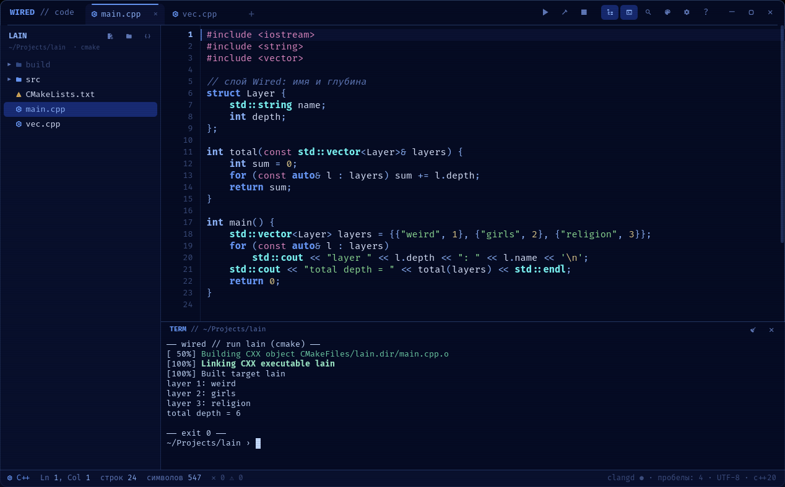
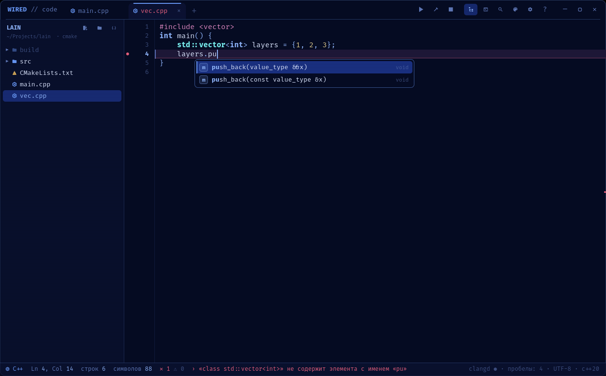

# WIRED // code

Лёгкий редактор кода в стиле *Serial Experiments Lain* для тех, кто учится программировать на **C++** и **Python**.
Без перегруженных меню: открыл папку, пишешь, жмёшь **F5**.

*A small Lain-styled code editor for C++ and Python learners (QML / Qt 6, KDE Plasma). Russian UI.*




## Что умеет

- **Подсветка** C++, Python и ещё ~300 языков (KSyntaxHighlighting) в цветах пяти тем Wired: ключевые слова, функции, `print` / `std::cout`, строки, числа — разными цветами
- **Ошибки на лету**: через секунду после набора файл проверяется (`g++ -fsyntax-only` для C++, разбор синтаксиса для Python) — метки на полях, текст ошибки в строке состояния, **F8** — к следующей
- **Автодополнение** C++ через clangd (после `.`, `->`, `::` или двух букв) и Python через jedi (после `.` или двух букв); у функций сами ставятся скобки
- **Подсказка параметров** после `(` и `,` — текущий параметр выделен; **описание под мышью** — тип и документация
- **К определению** — **F12** или Ctrl+клик (в том числе в заголовки стандартной библиотеки); **F2** — переименовать во всех файлах
- **Форматирование** — **Shift+Alt+F**: clang-format для C++ (или `.clang-format` проекта), black / ruff / autopep8 для Python
- **Шаблоны**: `for`, `if`, `main`, `cout`, `cin`, `class`, `def`… + **Tab**, по полям — Tab
- **Несколько курсоров**: **Ctrl+D** — то же слово ещё раз, **Alt+клик** — курсор где угодно
- **Сворачивание** блоков `{ }` и Python-блоков: стрелки на полях, **F9**, **Ctrl+F9** — всё, **Shift+F9** — развернуть
- **Поиск по проекту** — **Ctrl+Shift+F**; **структура файла** (функции и классы) — вкладка в боковой панели, **Ctrl+Shift+E**
- **Проекты**: дерево файлов, новый проект C++ (CMake) или Python в один клик, переименование, удаление в корзину, **Ctrl+P** — найти файл
- **Запуск** во встроенном терминале: **F5** — собрать и запустить (CMake-проект целиком или один `.cpp` через `g++ -Wall -g`, `.py` через `python3`), **Shift+F5** — стоп
- После запуска — **время и память** программы; **Ctrl+Shift+R** — сохранённый ввод для `std::cin` / `input()` и аргументы; **Ctrl+клик** по ошибке в терминале — к строке
- **Автосохранение** при запуске, смене вкладки и переходе в другое окно (отключается)
- **Хоткеи**, привычные по другим редакторам: Ctrl+/ комментарий, Ctrl+Shift+D дублировать, Alt+↑/↓ двигать строки, Ctrl+F / Ctrl+H поиск и замена, Ctrl+G к строке… Полный список — **F1**
- Номера строк, счётчик строк и символов, подсветка текущей строки и парных скобок, автозакрытие скобок и кавычек, умный отступ
- **Темы и вид**: 5 тем, шрифт и размер, размер интерфейса, прозрачность, отступ 2/4/8, стандарт C++17/20/23, анимации и строки развёртки отключаются
- Ничего не анимируется в покое — видеокарта не греется

## Установка (Arch / CachyOS, KDE Plasma 6)

```sh
sudo pacman -S qt6-declarative qmltermwidget syntax-highlighting python gcc cmake clang python-jedi python-black
git clone https://github.com/freefoxff288/wired-code
cd wired-code && ./install.sh
```

Запуск — из меню приложений или `wired-code [файл|папка]`. Всё ставится в домашнюю папку, без root.
`clang`, `python-jedi` и `python-black` нужны только для автодополнения и форматирования, `cmake` — для проектов с `CMakeLists.txt`.

## Как устроено

| Файл | Что делает |
|---|---|
| `Code.qml` | окно: вкладки, проект, терминал, запуск, проверка ошибок, панели, хоткеи |
| `Editor.qml` | один открытый файл: текст, подсветка, поля, правки, поиск, автодополнение |
| `TreeNode.qml` | дерево проекта |
| `runner.py` | запуск программы с замером времени и пиковой памяти (`wait4`) |
| `lsp.py` | мост к clangd (C++) и jedi (Python) — автодополнение, подсказки, переход к определению, переименование, структура, форматирование: QML не умеет говорить с процессом по stdin/stdout, поэтому мост отвечает редактору по HTTP на `127.0.0.1` со случайным токеном и завершается вместе с окном |
| `themes.js`, `syntax-themes/`, `colorschemes/` | палитры интерфейса, подсветки кода и терминала |

Настройки — `~/.config/wired-code.conf`.

Проверки: `QT_QPA_PLATFORM=offscreen qml tests/editor_test.qml` (правка текста, шаблоны, сворачивание, курсоры, автодополнение, сохранение) и `python3 lsp.py --test` (clangd, jedi, clang-format).

Часть рабочего стола [Wired](https://github.com/freefoxff288) — если он установлен, тема редактора следует за темой всего стола.

## Лицензия

GPL-3.0
